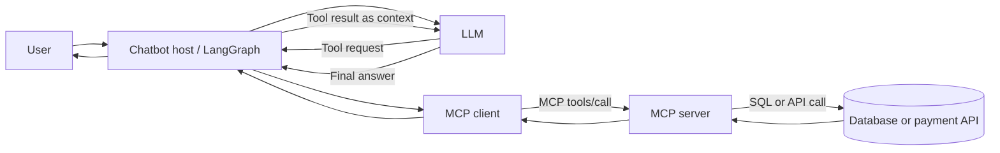
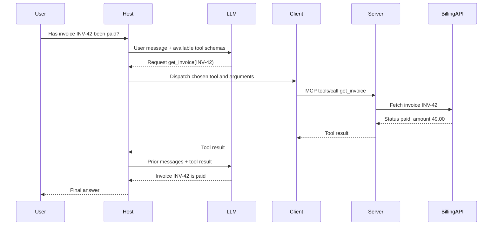
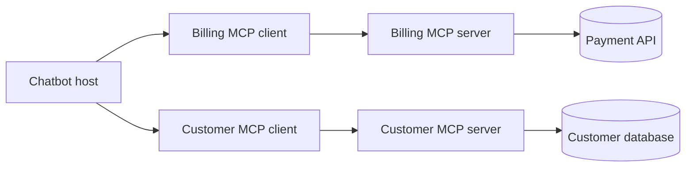

# MCP, from a math tool to a production chatbot

> **The idea in one line:** Model Context Protocol (MCP) is a standard way for an AI application to discover and use capabilities supplied by another program.

**Reading path:** [The pieces](#1-the-pieces) → [One complete request](#4-a-chatbot-request-step-by-step) → [Server designs](#6-one-server-or-many) → [Production checklist](#8-production-checklist).

---

## 1. The pieces

| Piece | Job | In our chatbot example |
|---|---|---|
| **Host** | Runs the conversation, LLM, and agent workflow; manages MCP connections. | Your LangGraph chatbot application. |
| **LLM** | Chooses whether to answer or request a tool call. | Selects `get_invoice` based on the question. |
| **MCP client** | Speaks MCP to a particular server on the host's behalf. | Your application's connection to the billing server. |
| **MCP server** | Advertises capabilities and executes requested operations. | A billing server exposing `get_invoice`. |
| **Underlying system** | Stores data or performs the business operation. | PostgreSQL, a billing API, or a payment provider. |

The **LLM usually does not send an MCP request itself**. Your application receives the model's tool request, decides whether it may run, and uses its MCP client to call the server. One host can have several MCP clients, typically one per connected server. [MCP architecture](https://modelcontextprotocol.io/docs/learn/architecture).



**Two different interfaces:** `host ↔ MCP server` uses MCP; `MCP server ↔ database/payment provider` uses whatever that system supports (SQL, REST, SDK, etc.). MCP standardizes the first interface; it does not replace the second.

## 2. What a server exposes

| Capability | Think of it as | Example |
|---|---|---|
| **Tool** | A callable operation. It may read or change data. | `get_invoice(id)`, `create_payment_link(id)` |
| **Resource** | Data the application can read as context. | `billing://policies/refunds` |
| **Prompt** | A reusable prompt template. | `explain_invoice(invoice_id)` |

A tool has a **name, description, input schema**, and result. The client can discover tools with `tools/list` and execute one with `tools/call`. A server may offer many tools. The LLM can select among the tools the host makes available to it; the host can also call a tool directly without asking the LLM to choose. [MCP server concepts](https://modelcontextprotocol.io/docs/learn/server-concepts).

Real tools might include `search_customer`, `get_order_status`, `list_overdue_invoices`, `create_refund_request`, and `search_repository`. They are ordinary functions behind an MCP interface; some call an API, some run a database query, and some work with local files.

> **Your `src/resources/` folder is project documentation.** It is unrelated to an MCP *resource* unless a server explicitly publishes its contents as one.

## 3. Your FastMCP server is a real MCP server

Your [`mathserver.py`](../learn_langgraph/2-MCP/mathserver.py) uses the Python SDK's `FastMCP` to expose `add` and `subtract`. The same pattern can wrap a business operation:

```python
# Example compatible with this project's installed mcp 1.x SDK.
from mcp.server.fastmcp import FastMCP

mcp = FastMCP("billing")

@mcp.tool()
def get_invoice(invoice_id: str) -> dict:
    """Return the current status and amount of an invoice by ID."""
    # Application code calls an authorized billing service here.
    return billing_api.get_invoice(invoice_id)

if __name__ == "__main__":
    mcp.run(transport="stdio")
```

`@mcp.tool()` registers the function; its name, type hints, and docstring help define what clients discover. `mcp.run(...)` starts the server and waits for client requests. The example assumes `billing_api` is a configured service wrapper; it is **illustrative**, not a standalone runnable file.

**Production grade is not a separate kind of MCP.** The same protocol and tool concept apply. A production server adds real identity and permissions, validation, bounded operations, secure credential handling, testing, monitoring, deployment, and maintenance. A company can publish its own MCP server; you can build yours with FastMCP or another SDK. [Python SDK](https://github.com/modelcontextprotocol/python-sdk).

> **Version note:** Your environment previously verified `mcp 1.30.0`, which supports `from mcp.server.fastmcp import FastMCP`. Current Python SDK 2.x documentation uses `from mcp.server import MCPServer`; check the installed version before copying newer examples. [Migration guide](https://github.com/modelcontextprotocol/python-sdk/blob/main/docs/migration.md).

## 4. A chatbot request, step by step

Suppose the user asks: **“Has invoice INV-42 been paid?”** The host already has an MCP connection to a billing server and has discovered `get_invoice`.



1. **Connection/discovery:** The host configures the MCP client and discovers available tools. This often happens before the user's question, not on every turn.
2. **Model decision:** The host sends the user message and relevant tool definitions to the LLM. The model returns either an answer or a *request* to call `get_invoice` with arguments.
3. **Dispatch:** The host checks its own policy and uses the appropriate MCP client. The client sends `tools/call` to the server.
4. **Execution:** The server validates the call, determines what the caller may access, and invokes its billing API or database code.
5. **Return:** The server sends a tool result through the client to the host. The host adds it to the conversation as a tool result.
6. **Answer:** The LLM reads that result and writes a user-facing answer. If it needs another tool, the agent loop can repeat.

The MCP client does **not** itself decide which tool is useful. The LLM can propose a call; the host controls dispatch and permissions; the server executes its own implementation.

### What if the user asks to pay an invoice?

Use separate, purpose-specific operations such as `get_invoice`, `create_payment_link`, and `get_payment_status`. A safe payment flow could be:

```text
User asks to pay → chatbot verifies invoice → server creates a provider-hosted
payment link → user completes payment with provider → webhook updates billing
system → chatbot checks verified payment status and reports it.
```

The LLM should not invent a successful charge. The payment provider and billing system are the source of truth. For a direct charge or refund, require appropriate authorization and explicit user confirmation, and design for retries so a repeated tool call cannot duplicate a charge. Keep card details and secret keys out of model context and tool descriptions.

## 5. Local, remote, and other useful distinctions

“Type of MCP server” can mean **where it runs**, **what it connects to**, or **who owns it**. These are different dimensions.

| Dimension | Common choices | When it fits |
|---|---|---|
| **Transport / location** | Local `stdio`; remote Streamable HTTP | Local developer tools versus shared hosted services. |
| **Ownership** | Your custom server; vendor or third-party server | Internal business data versus an existing provider integration. |
| **Backend** | Database, SaaS API, filesystem, internal service | Depends on the capability exposed. |
| **Effect** | Read-only or write-capable | `get_invoice` versus `issue_refund`. |
| **Deployment** | One local process; private service; hosted endpoint | Scale, reach, and operational needs. |

`stdio` normally means the host starts a local server process and communicates over its standard input/output. Streamable HTTP exposes an MCP endpoint that clients can reach over HTTP. Older HTTP+SSE transport has been superseded by Streamable HTTP; SSE may still appear *within* Streamable HTTP responses. [MCP transports](https://modelcontextprotocol.io/specification/2025-11-25/basic/transports).

**“Server” does not imply cloud hosting.** Your math server over stdio is a server, even though it runs as a local process.

## 6. One server or many?

Both designs are valid. Choose boundaries that make permissions, ownership, and operations understandable.



| Design | Good fit | Trade-off |
|---|---|---|
| **One server with several tools** | A cohesive domain, such as invoices, payment links, and payment status, owned by one team. | Simple to operate; all tools share a deployment and permission boundary unless you add finer controls. |
| **Several servers** | Different domains, teams, credentials, or risk levels, such as customer lookup and refunds. | Clearer separation; more connections and deployments to manage. |

A host may connect to your billing server *and* an existing vendor server. You generally **configure an MCP client** to consume an existing server; you **build an MCP server** when you want to publish your own capabilities. A LangGraph app using custom MCP tools often does both. Nothing requires MCP for every tool: direct LangGraph tools are fine when local code is simpler.

## 7. MCP versus direct tools and custom APIs

```text
Direct LangGraph tool: agent → Python function → service/API
MCP-backed tool:      agent → host's MCP client → MCP server → service/API
```

MCP gives clients a common way to **discover and call** server capabilities. It can reduce repeated integration code when several applications use the same tool provider. It does **not** guarantee “three agents × four tools = twelve API requests, reduced to four.” That arithmetic describes possible duplicated *integrations*, not the number of runtime requests. Each tool invocation may still make one or more normal API/database calls. Permissions, data formats, and business rules still need implementation.

## 8. Production checklist

For a billing or database server, ask these questions before making the tools broadly available:

| Concern | Practical design |
|---|---|
| **Identity and authorization** | Authenticate the client/user; scope each operation to the correct tenant and account. A valid MCP connection alone does not imply permission to every invoice. |
| **Tool scope** | Prefer `get_invoice(invoice_id)` over unrestricted SQL. Use read-only credentials for read-only tools. |
| **Sensitive actions** | Confirm charges, refunds, deletions, and external messages at the application layer; enforce authorization again inside the service. |
| **Input and output safety** | Validate IDs and amounts, limit result sizes, redact secrets and personal data, and treat tool results as untrusted data rather than instructions. |
| **Retries and failures** | Use timeouts, useful error responses, rate limits, and idempotency keys for actions that must not happen twice. |
| **Operations** | Log requests without exposing secrets; record audit events, metrics, and traces; monitor latency and failures. |
| **Deployment** | Pin compatible SDK/protocol versions, test real client/server connections, and protect HTTP endpoints with transport security and authentication. |

For HTTP servers, follow the transport's security requirements, including origin validation and appropriate authentication. For local stdio servers, keep protocol traffic on `stdout` and logs on `stderr`; arbitrary `print()` output can break a client. [MCP transport specification](https://modelcontextprotocol.io/specification/2025-11-25/basic/transports).

## 9. Quick answers to your earlier questions

| Question | Short answer |
|---|---|
| **Why host tools?** | To share a controlled capability across applications, separate its credentials and ownership, or deploy it independently. A simple agent can keep tools locally. |
| **What is FastMCP?** | A Python SDK interface for creating your own MCP server; your math example already uses it. |
| **Is a vendor server different in concept?** | No. It implements the same protocol, usually with more operational features and provider-specific tools. |
| **Do I build a client or server?** | Client/configuration to consume tools; server to publish tools. Many agent applications need only the former. |
| **Does an MCP server have to call an API?** | No. It can query a database, read a file, calculate locally, or call an API. |
| **Who executes the database query?** | The server-side tool implementation (or an authorized downstream service it calls), not the LLM. |
| **Is MCP the same as LangGraph?** | No. LangGraph manages agent state and workflow; MCP defines a way to expose and use external capabilities. |

---

### Further reading

- [MCP architecture and protocol flow](https://modelcontextprotocol.io/docs/learn/architecture)
- [Tools, resources, and prompts](https://modelcontextprotocol.io/docs/learn/server-concepts)
- [What an MCP client does](https://modelcontextprotocol.io/docs/learn/client-concepts)
- [Transport specification](https://modelcontextprotocol.io/specification/2025-11-25/basic/transports)
- [Python SDK and version migration](https://github.com/modelcontextprotocol/python-sdk/blob/main/docs/migration.md)
