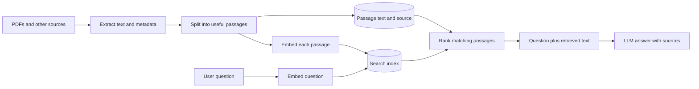
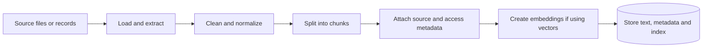
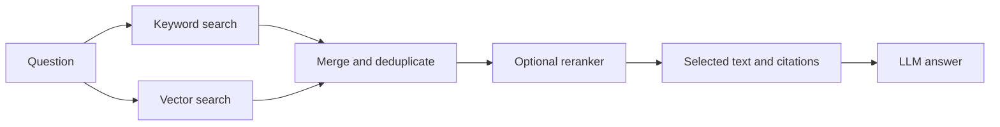

# Retrieval-Augmented Generation (RAG)

> **RAG = retrieve relevant external information, put it in the model's context, then generate an answer grounded in that information.** The retrieval method can use vectors, keywords, structured queries, or a combination.

**Read in order:** [Mental model](#1-the-mental-model) · [Ingestion](#2-ingestion-build-the-knowledge-base) · [Retrieval](#3-retrieval-answer-a-question) · [Vectorless RAG](#5-vectorless-rag) · [Production](#9-production-design).

---

## 1. The mental model

RAG has two phases. **Ingestion** prepares information for search, usually when content is added or changed. **Retrieval and generation** happen when a user asks a question. The model can answer from the retrieved evidence without its weights being updated. [Original RAG paper](https://arxiv.org/abs/2005.11401) · [Azure RAG overview](https://learn.microsoft.com/en-us/azure/search/retrieval-augmented-generation-overview).



**Critical distinction:** An embedding is a vector of numbers used to *find* passages. It is not a compressed passage that can be decoded back into the original words. The application retrieves the saved text (or follows its stored reference) and sends **that text** to the LLM.

### Four objects you will see in code

| Object | Example | What it is |
|---|---|---|
| Source | `northstar_support_policy.pdf` | Original file or record. |
| Chunk | `"A student may request a refund within 14 calendar days..."` | Extracted text passage. |
| Embedding | `[0.12, -0.08, ...]` | Numeric representation of one chunk or query. |
| Search hit | Chunk ID + text + metadata + rank/score | What the retriever gives the application. |

For example, encoding three chunks with a 384-dimensional model may produce a NumPy array of shape `(3, 384)`: three vectors, each containing 384 numbers. The dimension depends on the model. A vector index organizes those numbers for efficient nearest-neighbor search; it does not store words *inside* the model's weights.

## 2. Ingestion: build the knowledge base



| Step | What to do | Common mistake |
|---|---|---|
| Load | Extract readable text from PDFs, files, web pages, or approved database records. | Assuming a scanned PDF has extractable text; it may need OCR. |
| Clean | Remove repeated headers, broken extraction artifacts, and duplicates; preserve tables and meaningful headings. | Removing the context needed to interpret a passage. |
| Chunk | Split by headings, paragraphs, or a size limit; use overlap when boundaries would cut important context. | Chunks so small they lose meaning or so large they mix topics. |
| Tag | Add `source`, `page`, `section`, `updated_at`, `tenant_id`, access rules, and stable IDs where available. | Treating manually entered metadata as automatically verified fact. |
| Index | For vector RAG, embed chunks; for keyword RAG, create a text search index; for hybrid, do both. | Re-embedding a query with an incompatible model. |
| Refresh | Upsert changed chunks and remove old versions and deleted sources. | Leaving stale policy text searchable after an update. |

Your [RAG notebook](../learn_langgraph/3-TraditionalRAG/RAGPipeline.ipynb) already demonstrates PDF loading, `Document` objects, and `RecursiveCharacterTextSplitter`. Its `length_function=len` measures **characters**, so `chunk_size=1000` means about 1,000 characters, not 1,000 tokens. The first separators `"\n\n"`, `"\n"`, and `" "` prefer paragraph, line, and word boundaries; `""` is the fallback. The resulting chunk `Document` objects retain metadata from their source documents. [LangChain text splitting](https://docs.langchain.com/oss/python/integrations/splitters/recursive_text_splitter).

There is no universal best chunk size. Measure retrieval on your own questions. Preserve page and section metadata if you need citations.

### What an index entry might contain

```text
chunk_id:     northstar-support:v2:page1:refunds
text:         "A student may request a refund within 14 calendar days..."
vector:       [0.12, -0.08, 0.31, ...]   # only for vector retrieval
source:       northstar_support_policy.pdf
page:         1
section:      Refund window
tenant_id:    demo-training
updated_at:   2026-11-09
```

The schema above is illustrative. Different stores keep the text beside vectors, in a separate document store, or behind a reference. The **index is a search structure**; it is not necessarily a literal table of vectors lined up by topic.

## 3. Retrieval: answer a question

Suppose the user asks, **“Can I get my money back after 10 days?”**

1. The app checks the user's identity and allowed sources. It may rewrite a vague follow-up into a standalone question.
2. The retriever searches the authorized knowledge base. For vector search, it embeds the question and finds nearby chunk vectors. Short queries normally are **not chunked** first.
3. The app receives ranked candidates: text, IDs, source metadata, and possibly scores. Scores are system-specific; some APIs return distance where *lower* is better.
4. Optional filters or reranking choose passages that fit the question and context budget.
5. The app sends the **original retrieved text** with the question to the LLM. The LLM tokenizes this prompt internally, as it does with any text.
6. The model answers with citations if supported by the evidence, or says what is missing. The app returns the answer and source links/pages.

```text
Retriever result (illustrative)
1. source=northstar_support_policy.pdf, page=1, section=Refund window
   text="A student may request a refund within 14 calendar days of purchase
         if less than 20 percent of the course lessons have been completed."
2. source=northstar_support_policy.pdf, page=1, section=Exceptions
   text="A duplicate charge is reviewed even when the standard window has passed."

Prompt sent to LLM:
Question: Can I get my money back after 10 days?
Context: [the two retrieved passages, with their source labels]
Instruction: Answer only from the context; mention missing eligibility details.
```

A supported answer would say that 10 days is within the **fictional** 14-day window, but eligibility also depends on course completion. Retrieval provides **candidates**, not a guarantee that every returned sentence is relevant or true.

### Semantic search is a search algorithm, not an agent

The embedding model has learned a mapping from text to numbers. Similar phrasing may land near similar vectors; the search system compares these vectors using a configured distance or similarity measure. Your code decides when to search, which index to use, the filter, and how many results to return. An agent is optional: it can choose among search, SQL, APIs, or other tools, but a fixed retrieve-then-answer workflow is often enough.

## 4. Vector RAG

**Index time:** chunk text → embedding model → vector + text/reference + metadata.

**Question time:** question → same compatible embedding model → nearest-neighbor search → ranked passages → LLM.

Vector search helps when users paraphrase the source. A question about **“getting my money back”** may retrieve a section titled **“Refund window”** even without the word *refund* in the question. Exact IDs, dates, and product codes can be harder: semantic closeness alone may prefer a conceptually related but incorrect record. ANN (approximate nearest neighbor) indexes trade some exactness for speed at scale; exact scanning can suffice for small collections. [Azure vector search overview](https://learn.microsoft.com/en-us/azure/search/vector-search-overview).

Vector retrieval typically needs an embedding model, vector storage/indexing, model/version tracking, and query-time embedding. A vector database may hold the chunk text directly, but it is also valid to keep text in a separate store keyed by chunk ID.

## 5. Vectorless RAG

**Vectorless RAG means retrieval without generating or searching dense text embeddings.** It is still RAG if external information is selected and then supplied to a generator. “Vectorless” is an informal architecture label, not a separate protocol or one universal algorithm.

| Retrieval route | Example query | Why use it |
|---|---|---|
| Keyword/full-text search (often BM25) | Search a policy for `refund` and `14 days`. | Exact terms, names, and transparency; uses a text/inverted index. |
| Structured lookup (SQL/API) | `SELECT status FROM invoices WHERE id = ?` | Exact current records, permissions, and business fields. |
| Metadata filtering | `source=policy`, `region=BC`, `version=current` | Narrow a known corpus without semantic matching. |
| Navigational/hierarchical lookup | Select a manual's chapter and then its sections. | Documents with reliable structure or table of contents. |
| Knowledge graph traversal | Find a product, its approved policy, and linked exceptions. | Explicit relationships and provenance. |

Keyword search indexes terms from the source and ranks matching text; BM25 considers factors such as term frequency, document frequency, and document length. It does **not** require a text embedding vector. [Elastic full-text search](https://www.elastic.co/docs/solutions/search/full-text/how-full-text-works).

For a live invoice status, querying an authorized billing API and giving that result to the LLM is often preferable to searching a stale copy of invoices. Some teams call this *tool-augmented generation*; in this guide, it counts as retrieval-augmented answering because external evidence is fetched at question time. The core point is the same: the LLM reads **returned text or structured fields**, not vectors.

## 6. Hybrid and other patterns



| Pattern | Retrieval trigger | Useful when |
|---|---|---|
| **Two-step RAG** | Application always retrieves before answering. | Straightforward document Q&A with predictable latency. |
| **Agentic RAG** | LLM can decide which retriever or tool to use, possibly in several rounds. | Multi-source questions or mixed document/live-data workflows. |
| **Hybrid retrieval** | Keyword and vector search both run, then results are merged/reranked. | Queries mix paraphrases with exact codes or names. |
| **Multimodal RAG** | Retrieve text plus image, audio, or other indexed content. | Diagrams, screenshots, recordings, or charts matter. |

Here **hybrid retrieval** means combining keyword and vector search. Some frameworks also use **hybrid RAG** for a workflow that mixes fixed retrieval with agent decisions and validation; that is a different use of the word *hybrid*. Hybrid retrieval should earn its added cost and complexity through evaluation. [Azure hybrid search](https://learn.microsoft.com/en-us/azure/search/hybrid-search-overview) · [LangChain retrieval overview](https://docs.langchain.com/oss/python/langchain/retrieval).

### Choose a first retrieval strategy

| Your data/question | Start with |
|---|---|
| A handful of short documents that fit in context | Direct context or simple keyword lookup; measure before adding infrastructure. |
| Natural-language questions over many manuals | Vector search, then compare with hybrid. |
| SKU, invoice ID, legal clause number, exact phrase | Keyword or structured lookup. |
| Both paraphrase and exact identifier | Hybrid search. |
| Fresh account balance or payment status | Authorized live API/SQL lookup. |

## 7. Real-world scenarios

| Scenario | Retrieval source | Answer behavior |
|---|---|---|
| Customer support policy bot | Versioned policy PDFs and help-center pages | Cite current refund and access rules; ask for missing eligibility facts. |
| Internal engineering assistant | Runbooks, design docs, incident notes | Find the relevant procedure and link to its version; restrict confidential docs by team. |
| Sales enablement | Approved pricing sheets, product specs, CRM data | Use documents for product claims and a live system for customer-specific terms. |
| Financial operations assistant | Invoice database, payment API, policy docs | Retrieve exact status from live records; use policy text for explanations; do not invent a completed payment. |
| Research literature assistant | Papers and extracted sections | Return findings with paper and section citations; separate evidence from synthesis. |

These are *patterns*, not guarantees of compliance or factual accuracy. High-impact answers need authoritative sources, access controls, and review appropriate to the domain.

## 8. What RAG is and is not

| Question | Practical answer |
|---|---|
| Does ingestion train the LLM? | Usually no. It builds or updates an external search source. |
| Do vectors become text again? | No. Search finds IDs; the app fetches saved source text. |
| Does the LLM need every PDF? | No. It usually sees a small set of selected passages. |
| Do I need LangGraph or an agent? | No. A normal function can retrieve and then call the LLM. |
| Is a `Document` docstring an agent tool? | No. Tools must be deliberately exposed to an agent. |
| Does a citation prove the answer? | No. Check that the cited passage actually supports the claim. |
| Does RAG replace fine-tuning? | They solve different problems: RAG supplies external evidence; fine-tuning changes model behavior/weights. They can be combined. |

## 9. Production design

```text
Source systems → ingestion jobs → versioned, permission-aware index
User → application auth → authorized retrieval → reranking/context packing
     → LLM → citation and answer checks → response + traces
```

| Area | Production practice |
|---|---|
| **Permissions** | Enforce document/tenant access **during retrieval**, before text reaches the model. Recheck authorization when fetching a hit by ID. A source label alone is not an access control. [Azure document security](https://learn.microsoft.com/en-us/azure/search/search-security-best-practices). |
| **Freshness** | Track source IDs, revisions, timestamps, deletions, and failed updates. Rebuild or migrate indexes when changing embedding models or index schemas. |
| **Extraction** | Test PDF text, tables, scans/OCR, encodings, and page metadata on real source examples. |
| **Security** | Treat retrieved passages as untrusted input: they can contain prompt injection. Keep secrets out of the index and logs; constrain what tools an agent may use. |
| **Evidence** | Keep stable chunk-to-source pointers. Provide page/section citations and an “I couldn't find it” path when evidence is weak or missing. |
| **Reliability** | Bound retrieval and LLM timeouts, define fallbacks, deduplicate hits, cap context size, and observe ingestion failures. |
| **Cost/latency** | Monitor extraction, embedding, search, reranking, and generation separately. Cache carefully where permissions and freshness allow. |
| **Evaluation** | Maintain questions with expected sources and supported answers. Track retrieval recall@k, ranking quality, answer support/faithfulness, citation correctness, no-answer behavior, latency, and cost. |

### A small evaluation set from this repository

Use the [demo text files](../learn_langgraph/3-TraditionalRAG/data/text_files/) and [demo PDFs](../learn_langgraph/3-TraditionalRAG/data/pdf/) as a starter set:

| Test question | Expected source |
|---|---|
| “What does `dict.get` do when a key is missing?” | `python_intro.txt` |
| “What is overfitting?” | `machine_learning.txt` |
| “Why do chunks overlap?” | `rag_pipeline.txt` or `vector_search_field_guide.pdf` |
| “What is the fictional refund window?” | `northstar_support_policy.pdf` |
| “What was a real customer charged today?” | **No answer in these demo files**; ask for an authorized live source. |

The last case matters as much as the first four: a production system must know when its knowledge base cannot answer.

---

### Sources and deeper reading

- [Original RAG research paper](https://arxiv.org/abs/2005.11401)
- [LangChain: retrieval and RAG architectures](https://docs.langchain.com/oss/python/langchain/retrieval)
- [Microsoft: RAG overview](https://learn.microsoft.com/en-us/azure/search/retrieval-augmented-generation-overview)
- [Microsoft: hybrid search](https://learn.microsoft.com/en-us/azure/search/hybrid-search-overview)
- [Elastic: how full-text search works](https://www.elastic.co/docs/solutions/search/full-text/how-full-text-works)
